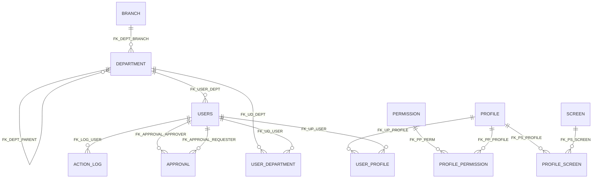

# firebird-5-mcp

Um servidor MCP (Model Context Protocol) leve e 100% em Rust para bancos de dados Firebird 5. Sem dependências externas — sem `isql`, sem DLLs, sem arquivos `.so`. Apenas um único binário estático.

## Funcionalidades

### Schema & Estrutura
- `firebird_describe_database` — Visão completa do banco com seção de Health (estilo gstat) + diagrama ER em Mermaid
- `firebird_describe_table` — Schema completo de uma tabela (colunas, índices, constraints, triggers, comentários)
- `firebird_describe` — Describe de múltiplos objetos (tabelas, views, procedures, funções, triggers, sequências, domains)
- `firebird_list` — Lista tabelas, views, procedures, funções, domains, triggers, índices, sequências
- `firebird_check_duplicates` — Verifica valores duplicados antes de criar índice/constraint único

### DDL & Avançado
- `firebird_create_database` — Cria um novo arquivo de banco de dados Firebird
- `firebird_alter_column_type` — Altera o tipo de uma coluna usando domains
- `firebird_create_trigger` — Cria triggers BEFORE/AFTER de INSERT/UPDATE/DELETE
- `firebird_create_procedure` — Cria procedures armazenadas (sem isql)
- `firebird_create_function` — Cria funções definidas pelo usuário
- `firebird_create_sequence` — Cria sequências (generators)
- `firebird_drop` — Remove tabelas, views, domains, triggers, procedures, funções, índices, sequências
- `firebird_run_script` — Executa scripts SQL com múltiplas instruções
- `firebird_execute_immediate` — Executa instruções com blocos SET TERM (procedures, funções, generators)

### Query & Dados
- `firebird_query` — Executa qualquer instrução SQL (SELECT, INSERT, UPDATE, DELETE, DDL)
- `firebird_count` — Conta linhas de uma tabela (com WHERE opcional)
- `firebird_sample` — Amostra rápida de dados de uma tabela
- `firebird_insert_batch` — Inserção em lote de múltiplas linhas em uma única transação

### Geração de Código
- `firebird_generate_dev` — Gera código de desenvolvimento a partir dos schemas das tabelas (Java, Go, Rust, TypeScript, Protobuf, OpenAPI, GraphQL, Python, JSON Schema, Lazarus, Svelte 5)
- `firebird_generate_view_dto` — Gera DTOs/records a partir de views (mesmas linguagens)

### Descoberta
- `firebird_get_databases` — Lista os bancos configurados
- `firebird_metadata_extract` — Extração completa de DDL (substitui `isql -x`)
- `firebird_explain_plan` — Obtém o plano de execução sem executar a query (transação revertida)
- `firebird_find_column` — Encontra colunas por padrão de nome (LIKE) em todas as tabelas/views

### Introspecção
- `firebird_table_stats` — Contagem de linhas por tabela (uma tabela ou todas)
- `firebird_users` — Lista todos os usuários com acesso ao banco (criadores + grants)
- `firebird_grants` — Mostra GRANTs de uma tabela ou de todas as tabelas
- `firebird_blob_info` — Lista colunas BLOB com subtipo (TEXT/BINARY)
- `firebird_index_usage` — Mostra todos os índices com colunas, unicidade e tipo
- `firebird_domains` — Analisa domínios definidos pelo usuário (contagem de uso, assinaturas de tipo, sugestões)
- `firebird_crypt_state` — Estado de criptografia em repouso + versão do engine
- `firebird_database_stats` — Snapshot de MON$DATABASE (tamanho, I/O, transações, attachments)
- `firebird_query_history` — Ativas/ociosas/travadas de MON$STATEMENTS

### Qualidade de Dados
- `firebird_data_quality` — Verificações de qualidade de dados baseadas em regras (nulos, strings vazias, outliers, intervalo de datas)

### Gerenciamento de Arquivos
- `firebird_list_files` — Lista arquivos gerados no diretório de armazenamento (codegen, export, metadata)

### Migração de Dados
- `firebird_export` — Exporta tabela/view/SQL para Parquet, Arrow IPC, CSV, DBF ou JSON Lines (com compressão)
- `firebird_import` — Importa Parquet/IPC/CSV/DBF/JSONL para tabela Firebird (create/append + ignore_columns)
- `firebird_describe_file` — Inspecciona o schema do arquivo sem carregar dados (sem conexão com o banco)

> **⚠️ Não recomendado para bancos de produção.**
> Este MCP foi desenhado para fluxos de desenvolvimento e análise. Ferramentas como geração de código,
> operações DDL e instruções de refactoring podem ser destrutivas. Para produção,
> use uma ferramenta de administração dedicada (ex.: `isql`, `fbguard`, ou a suíte preferida do seu DBA).

> **Em breve:** um modo **safe-readonly** (somente leitura segura).

## Pré-requisitos

- Servidor **Firebird 5** em execução (ou qualquer versão 3+)
- Não requer `isql`, ODBC nem bibliotecas nativas

## Configuração

### `config.json`

O arquivo de configuração define a conexão com o servidor Firebird e a lista de bancos disponíveis para as ferramentas MCP.

```json
{
  "server": {
    "host": "localhost",
    "port": 3050,
    "user": "SYSDBA",
    "password": "masterkey",
    "allowed_paths": ["/caminho/para/bancos"],
    "databases": [
      {
        "name": "examples",
        "description": "Banco de desenvolvimento local",
        "path": "/caminho/para/bancos/examples.fdb"
      }
    ],
    "default_database": "examples"
  }
}
```

| Campo | Descrição |
|-------|-------------|
| `host` | Hostname do servidor Firebird |
| `port` | Porta do servidor Firebird (padrão 3050) |
| `user` | Usuário do banco de dados |
| `password` | Senha do banco de dados |
| `allowed_paths` | Diretórios onde novos bancos podem ser criados |
| `databases` | Lista de bancos configurados |
| `default_database` | Banco usado quando nenhum é especificado |

### Entrada de banco

Cada entrada do array `databases`:

```json
{
  "name": "examples",
  "description": "Banco de desenvolvimento local",
  "path": "/caminho/para/bancos/examples.fdb"
}
```

### Busca do arquivo de configuração

O servidor procura o `config.json` nesta ordem:
1. Variável de ambiente `FIREBIRD_CONFIG` (caminho completo)
2. `./config.json` (diretório de trabalho atual)
3. `~/.firebird-mcp/config.json` (padrão)

> **Nota:** Na primeira execução, se `~/.firebird-mcp/config.json` não existir, o servidor cria um arquivo de configuração vazio naquele local. Você pode então editá-lo para adicionar a conexão com o servidor e os bancos.

O diretório base pode ser sobrescrito com `FIREBIRD_MCP_HOME` (ex.: para testes ou instalações fora do padrão).

### Variáveis de ambiente

| Variável | Descrição |
|----------|-------------|
| `FIREBIRD_CONFIG` | Caminho completo para o `config.json` (maior prioridade) |
| `FIREBIRD_MCP_HOME` | Sobrescreve o diretório base (padrão: `~/.firebird-mcp`) |

## Guias de Instalação

| Guia | Descrição |
|-------|-------------|
| [README_ZED_EDITOR.md](README_ZED_EDITOR.md) | Configuração no Zed Editor |
| [README_VSCODE.md](README_VSCODE.md) | Configuração no VSCode & Cursor |
| [README_JETBRAINS.md](README_JETBRAINS.md) | Configuração em IDEs JetBrains |
| [README_COMMAND_LINE.md](README_COMMAND_LINE.md) | Uso pela linha de comando (sem IDE) |
| [examples/freePascal/README.md](examples/freePascal/README.md) | Integração Free Pascal / Lazarus |
| [README_CODEGEN.md](README_CODEGEN.md) | Exemplos de geração de código (todas as linguagens) |
| [README_FOR_DEVS.md](README_FOR_DEVS.md) | Build, cross-compilação, estrutura do projeto |
| [README_MIGRATIONS.md](README_MIGRATIONS.md) | Migração de dados (Parquet/IPC/CSV/DBF) |
| [LEIAME_PARA_HUMANOS.md](LEIAME_PARA_HUMANOS.md) | Uso como CLI puro — sem agente de IA |
| [README.md](README.md) | Este README em inglês |

## Ferramentas

### `firebird_query`

Executa uma única instrução SQL. Para DML/DDL, o plano de execução é anexado ao resultado.

**Argumentos:**
- `sql` (obrigatório): A instrução SQL
- `database` (opcional): Nome do banco (padrão: `default_database`)

**Exemplo:**
```json
{
  "sql": "SELECT * FROM CLIENTS WHERE CITY = 'New York'",
  "database": "shop"
}
```

**Resultado:**
### Query Results (3 rows)

Columns: ID (INT), NAME (VARCHAR), CITY (VARCHAR)

ID | NAME | CITY
--- | --- | ---
1 | Alice | New York
2 | Bob | NULL
3 | Charlie | New York

### `firebird_list`

Lista objetos do banco por tipo.

**Argumentos:**
- `type` (obrigatório): TABLES, PROCEDURES, FUNCTIONS, DOMAINS, TRIGGERS, INDEXES ou SEQUENCES
- `database` (opcional): Nome do banco

**Exemplo:**
```json
{
  "type": "TABLES",
  "database": "shop"
}
```

**Resultado:**
### Tables and Views (5)

NAME | TYPE | COMMENT
--- | --- | ---
CLIENTS | TABLE | Customer records
ORDERS | TABLE | Order data
...

### `firebird_find_column`

Encontra colunas por padrão de nome em todas as tabelas e views. Suporta wildcards `%`.

**Argumentos:**
- `column` (obrigatório): Padrão do nome da coluna (suporta wildcards `%`). Ex.: `EMAIL`, `%NOME%`, `ID`
- `database` (opcional): Nome do banco

**Exemplo:**
```json
{
  "column": "%EMAIL%",
  "database": "shop"
}
```

**Resultado:**
### Columns matching '%EMAIL%' (2 found)

TABLE | COLUMN | TYPE | NULL | VIEW
--- | --- | --- | --- | ---
USERS | EMAIL | VARCHAR(250) | NO |
VW_ACTIVE_USERS | EMAIL | VARCHAR(250) | YES | YES

### `firebird_check_duplicates`

Verifica valores duplicados em uma ou mais colunas. Use isto ANTES de criar um índice ou constraint único para verificar a integridade dos dados. Suporta chaves compostas.

**Argumentos:**
- `table` (obrigatório): Nome da tabela a verificar
- `columns` (obrigatório): Array de nomes de colunas a verificar (suporta chaves compostas)
- `limit` (opcional): Máximo de combinações duplicadas a retornar (padrão: 10)
- `database` (opcional): Nome do banco

**Exemplo:**
```json
{
  "table": "CUSTOMERS",
  "columns": ["TYPE_ID"],
  "database": "shop"
}
```

**Resultado (com duplicados):**
### Duplicate Check: CUSTOMERS (TYPE_ID)

⚠️ 1 duplicate combination(s) found:

TYPE_ID | DUPLICATED_COUNT
--- | ---
2 | 5

#### Full rows for first duplicate (TYPE_ID = 2):

ID | TYPE_ID | PARENT_ID | IS_VERIFIED | ACTIVE | ...
--- | --- | --- | --- | --- | ---
2 | 2 | NULL | false | true | ...
3 | 2 | 2 | true | true | ...
4 | 2 | NULL | false | true | ...
5 | 2 | 4 | true | true | ...
6 | 2 | 4 | false | true | ...

💡 Fix duplicates before creating the unique index/constraint.


**Resultado (sem duplicados):**
### Duplicate Check: CUSTOMERS (ID)

✅ No duplicates found. Safe to create unique index/constraint.

### `firebird_describe_table`

Mostra o schema completo de uma tabela ou view.

**Argumentos:**
- `table_name` (obrigatório): Nome da tabela ou view
- `database` (opcional): Nome do banco

**Resultado:**
### Table: CLIENTS

#### Columns

NAME | TYPE | NULL | DEFAULT | POSITION
--- | --- | --- | --- | ---
ID | INTEGER | NO | - | 1
NAME | VARCHAR(100) | NO | - | 2
EMAIL | VARCHAR(255) | YES | - | 3
CREATED_AT | TIMESTAMP | NO | CURRENT_TIMESTAMP | 4

#### Indexes

NAME | UNIQUE | TYPE | COLUMNS
--- | --- | --- | ---
PK_CLIENTS | YES | 0 | ID

#### Constraints

NAME | TYPE
--- | ---
PK_CLIENTS | PRIMARY KEY

### `firebird_describe_database`

Fornece uma visão completa da estrutura do banco com uma seção de Health (informações estilo gstat) e um diagrama ER em Mermaid.

**Argumentos:**
- `database` (opcional): Nome do banco
- `include_counts` (opcional): Incluir contagem de linhas (pode ser lento)
- `include_describes` (opcional): Incluir detalhes das colunas

**Resultado:**

### Database: test-mcp

#### Health

- **Path:** /database/test-mcp.fdb
- **ODS Version:** 13.1
- **Page Size:** 32768 bytes
- **File Size:** 283 pages (~8.8 MB)
- **Dialect:** 3
- **Mode:** Online (Normal)
- **Read-Only:** NO
- **Forced Writes:** YES
- **Active Connections:** 1
- **Oldest Transaction:** 361 (active: 362, next: 362)
- **Buffer Pool:** 2048 pages

#### Tables (14)

**USERS** (10 rows)
- ID (INTEGER)
- DEPARTMENT_ID (INTEGER)
- NAME (VARCHAR(25))
- EMAIL (VARCHAR(50))
- PASSWORD_HASH (VARCHAR(125))
- ACTIVE (BOOLEAN)
- SALARY (NUMERIC(14,2))
- HIRED_AT (DATE)
- CREATED_AT (TIMESTAMP)
- UPDATED_AT (TIMESTAMP)

**DEPARTMENT** (10 rows)
- ID (INTEGER)
- BRANCH_ID (INTEGER)
- PARENT_ID (INTEGER, NOT NULL)
- NAME (VARCHAR(25))
- CODE (VARCHAR(5))
- TYPE (VARCHAR(5))
- ACTIVE (BOOLEAN, NOT NULL)
- CREATED_AT (TIMESTAMP)
- UPDATED_AT (TIMESTAMP)

**BRANCH** (4 rows)
- ID (INTEGER)
- NAME (VARCHAR(25))
- CODE (VARCHAR(2))
- ACTIVE (BOOLEAN)
- CREATED_AT (TIMESTAMP)
- UPDATED_AT (TIMESTAMP)

**PROFILE** (5 rows)
- ID (INTEGER)
- NAME (VARCHAR(25))
- DESCRIPTION (VARCHAR(125), NOT NULL)
- ACTIVE (BOOLEAN)
- CREATED_AT (TIMESTAMP)

**PERMISSION** (10 rows)
- ID (INTEGER)
- CODE (VARCHAR(12))
- NAME (VARCHAR(25))
- MODULE (VARCHAR(12))
- ACTIVE (BOOLEAN)

**SCREEN** (8 rows)
- ID (INTEGER)
- NAME (VARCHAR(25))
- MODULE (VARCHAR(12))
- PATH (VARCHAR(50))
- ACTIVE (BOOLEAN, NOT NULL)

**USER_PROFILE** (10 rows)
- ID (INTEGER)
- USER_ID (INTEGER)
- PROFILE_ID (INTEGER)

**USER_DEPARTMENT** (12 rows)
- ID (INTEGER)
- USER_ID (INTEGER)
- DEPARTMENT_ID (INTEGER)
- PRIMARY_FLAG (BOOLEAN, NOT NULL)
- START_DATE (DATE)
- END_DATE (DATE, NOT NULL)
- ACTIVE (BOOLEAN, NOT NULL)

**PROFILE_PERMISSION** (25 rows)
- ID (INTEGER)
- PROFILE_ID (INTEGER)
- PERMISSION_ID (INTEGER)

**PROFILE_SCREEN** (20 rows)
- ID (INTEGER)
- PROFILE_ID (INTEGER)
- SCREEN_ID (INTEGER)

**ACTION_LOG** (10 rows)
- ID (INTEGER)
- USER_ID (INTEGER)
- ACTION (VARCHAR(12))
- ENTITY (VARCHAR(12))
- ENTITY_ID (INTEGER, NOT NULL)
- DETAILS (VARCHAR(250), NOT NULL)
- CREATED_AT (TIMESTAMP)

**APPROVAL** (8 rows)
- ID (INTEGER)
- REQUESTER_ID (INTEGER)
- APPROVER_ID (INTEGER)
- STATUS (VARCHAR(5))
- REASON (VARCHAR(125), NOT NULL)
- APPROVED_AT (TIMESTAMP, NOT NULL)
- CREATED_AT (TIMESTAMP)

#### Relationships (Mermaid)



**Campos da seção Health:**
| Campo | Descrição |
|-------|-------------|
| Path | Caminho do arquivo do banco |
| ODS Version | Versão da estrutura em disco (On-Disk Structure) (13.1 = Firebird 5) |
| Page Size | Tamanho da página em bytes |
| File Size | Total de páginas e tamanho estimado em MB |
| Dialect | Dialeto SQL (3 = ANSI) |
| Mode | Modo de shutdown: Online (Normal), Multi-user, Single-user, Full |
| Read-Only | Se o banco é somente leitura |
| Forced Writes | Se forced writes está habilitado |
| Active Connections | Número de conexões de usuário ativas |
| Oldest Transaction | ID da transação mais antiga (ativa e próxima) |
| Buffer Pool | Número de páginas do buffer pool |

### `firebird_describe`

Describe de múltiplos objetos — aceita qualquer combinação de tabelas, views, procedures, funções, triggers, sequências e domains.

**Argumentos:**
- `objects` (obrigatório): Array de nomes de objetos
- `database` (opcional): Nome do banco

**Exemplo:**
```json
{
  "objects": ["SAVE_USER", "USERS", "D_BOOL"],
  "database": "shop"
}
```

**Resultado (procedure com parâmetros):**
### SAVE_USER (PROCEDURE)

#### Input Parameters

POSITION | NAME | DOMAIN
--- | --- | ---
0 | P_OPER | RDB$33
1 | P_ID | D_ID_NULL
2 | P_EMAIL | D_VC255
...

#### Output Parameters

POSITION | NAME | DOMAIN
--- | --- | ---
0 | ID | D_ID
1 | OK | D_BOOL

#### Source

CREATE PROCEDURE SAVE_USER (P_OPER RDB$33, P_ID D_ID_NULL, ...)
AS
DECLARE VARIABLE V_AFF INT;
BEGIN
    ...
END

### `firebird_generate_dev`

Gera código de desenvolvimento a partir dos schemas das tabelas. Veja [README_CODEGEN.md](README_CODEGEN.md) para exemplos em todas as linguagens suportadas.

**Argumentos:**
- `tables` (obrigatório): Array de nomes de tabelas (máx. 20)
- `language` (obrigatório): `java`, `go`, `rust`, `typescript`, `protobuf`, `openapi`, `graphql`, `python`, `json_schema`, `lazarus` ou `svelte`
- `database` (opcional): Nome do banco
- `include_fks` (opcional): Se true, gera relações FK nomeadas (Java `@ManyToOne`) ou comentários de FK

### `firebird_explain_plan`

Obtém o plano de execução de uma instrução SQL sem efetivamente executá-la. A instrução é executada dentro de uma transação revertida.

**Argumentos:**
- `sql` (obrigatório): A instrução SQL
- `database` (opcional): Nome do banco

**Resultado:**
Execution plan (the statement was executed inside a rolled-back transaction):
PLAN:
  SORT
    TABLE: CLIENTS (INDEX: PK_CLIENTS)

### `firebird_metadata_extract`

Extrai os metadados completos do banco (DDL) usando as tabelas de sistema. Substitui `isql -x`.

**Argumentos:**
- `database` (opcional): Nome do banco
- `objects` (opcional): Array de nomes de objetos para filtrar (ex.: `["CLIENTS", "ORDERS"]`)
- `outputDirPath` (opcional): Diretório para salvar o arquivo DDL (retorna o caminho em vez do DDL inline)

**Resultado:**
```sql
CREATE TABLE CLIENTS (
    ID INTEGER NOT NULL,
    NAME VARCHAR(100) NOT NULL,
    EMAIL VARCHAR(255),
    CREATED_AT TIMESTAMP DEFAULT CURRENT_TIMESTAMP NOT NULL,
    CONSTRAINT PK_CLIENTS PRIMARY KEY (ID)
);

CREATE INDEX IDX_CLIENTS_EMAIL ON CLIENTS (EMAIL);
...
```

### `firebird_table_stats`

Retorna a contagem de linhas por tabela. Para uma única tabela, usa `SELECT COUNT(*) FROM <tabela>`. Para todas as tabelas, usa um `EXECUTE BLOCK` com `EXECUTE STATEMENT` para contar dinamicamente cada tabela.

**Argumentos:**
- `table` (opcional): Nome da tabela. Omita para obter estatísticas de todas as tabelas.
- `database` (opcional): Nome do banco

**Resultado:**
## Table Stats (all tables)

TABLE_NAME | TOTAL
--- | ---
ACTION_LOG | 10
APPROVAL | 8
BRANCH | 4
DEPARTMENT | 10
PERMISSION | 10
PROFILE | 5
PROFILE_PERMISSION | 25
PROFILE_SCREEN | 20
SCREEN | 8
USERS | 10
USER_DEPARTMENT | 12
USER_PROFILE | 10

> **Nota:** `COUNT(*)` em tabelas muito grandes pode ser lento. Destinado a desenvolvimento/análise.

### `firebird_users`

Lista todos os usuários com acesso ao banco, combinando `RDB$DB_CREATORS` (donos do banco) com `RDB$USER_PRIVILEGES` (usuários com grants explícitos).

**Argumentos:**
- `database` (opcional): Nome do banco

**Resultado:**
## Database Users

USER_NAME | CREATOR_TYPE | PRIVILEGE | GRANT_OPTION
--- | --- | --- | ---
SYSDBA | 0 |  | 
APP_USER |  | SELECT | 
APP_USER |  | INSERT | 
APP_USER |  | UPDATE | 

> **Nota:** Os privilégios são exibidos como letras únicas: `S` = SELECT, `I` = INSERT, `U` = UPDATE, `D` = DELETE, `R` = REFERENCES, `G` = GRANT OPTION.

### `firebird_grants`

Mostra os privilégios GRANT de uma tabela específica ou de todas as tabelas, usando `RDB$USER_PRIVILEGES`.

**Argumentos:**
- `table` (opcional): Nome da tabela. Omita para mostrar grants de todas as tabelas.
- `database` (opcional): Nome do banco

**Resultado:**
## Grants for CLIENTS

RELATION_NAME | GRANTEE | PRIVILEGE | GRANT_OPTION
--- | --- | --- | ---
CLIENTS | APP_USER | SELECT | 
CLIENTS | APP_USER | INSERT | 
CLIENTS | APP_USER | UPDATE | 

### `firebird_blob_info`

Lista todas as colunas BLOB do banco (ou de uma tabela específica): tabela, coluna, subtipo do blob (TEXT/BINARY) e comprimento do campo.

**Argumentos:**
- `table` (opcional): Nome da tabela. Omita para listar colunas BLOB de todas as tabelas.
- `database` (opcional): Nome do banco

**Resultado:**
## BLOB Columns (all tables)

RELATION_NAME | FIELD_NAME | FIELD_TYPE | SUB_TYPE | LENGTH | BLOB_TYPE
--- | --- | --- | --- | --- | ---
DOCUMENTS | CONTENT | 261 | 1 | 0 | TEXT
INVOICES | PDF_DATA | 261 | 2 | 0 | BINARY

### `firebird_index_usage`

Mostra todos os índices do banco (ou de uma tabela específica): nome do índice, tabela, unicidade, tipo e colunas.

**Argumentos:**
- `table` (opcional): Nome da tabela. Omita para mostrar índices de todas as tabelas.
- `database` (opcional): Nome do banco

**Resultado:**

## Indexes (all tables)

INDEX_NAME | RELATION_NAME | UNIQUE_FLAG | INDEX_TYPE | COLUMNS
--- | --- | --- | --- | ---
PK_CLIENTS | CLIENTS | 2 | 0 | ID
IDX_CLIENTS_EMAIL | CLIENTS | 1 | 0 | EMAIL
IDX_ORDERS_CLIENT | ORDERS | 0 | 0 | CLIENT_ID, CREATED_AT

| UNIQUE_FLAG | Significado |
|---|---|
| 0 | Não único |
| 1 | Único |
| 2 | Chave primária |

### `firebird_domains`

Analisa domínios definidos pelo usuário: lista cada domínio com seu tipo, nullabilidade, default e contagem de uso (quantas colunas o utilizam), mostra as assinaturas de tipo mais comuns e sugere domínios que poderiam ser criados para tipos comuns que não possuem um.

**Argumentos:**
- `database` (opcional): Nome do banco

### `firebird_data_quality`

Executa regras configuráveis de qualidade de dados em uma única tabela. Regras: **nulls** (NULOs em colunas NOT NULL), **empty_strings** (strings vazias em colunas de texto), **outliers** (outliers baseados em IQR em colunas numéricas), **date_range** (datas fora de [1900-01-01, hoje+1]).

**Argumentos:**
- `table` (obrigatório): Nome da tabela
- `rules` (opcional): Array de regras para executar (default: todas). Valores: `nulls`, `empty_strings`, `outliers`, `date_range`
- `columns` (opcional): Array de nomes de colunas para limitar a análise
- `output_format` (opcional): `markdown` (default) ou `json`
- `sample_limit` (opcional): Máximo de valores de amostra por finding (default 5, máx 20)
- `database` (opcional): Nome do banco

### `firebird_list_files`

Lista arquivos gerados (codegen, export, metadata) no diretório de armazenamento. Funciona em ambos os transports (stdio e SSE).

**Argumentos:**
- `database` (opcional): Filtrar por nome do banco
- `format` (opcional): Filtrar por formato (ex.: `java`, `parquet`, `sql`)
- `max_age_hours` (opcional): Apenas arquivos modificados nas últimas N horas
- `outputDirPath` (opcional): Sobrescrever o diretório de armazenamento

### `firebird_crypt_state`

Retorna o estado de criptografia em repouso do banco (`MON$DATABASE.MON$CRYPT_STATE`, Firebird 3.0+) e a versão do engine.

**Argumentos:**
- `database` (opcional): Nome do banco

### `firebird_database_stats`

Retorna um snapshot de estatísticas do banco: `MON$DATABASE` (tamanho, page size, ODS, dialect, owner, data de criação), contadores de transações, I/O acumulado, attachments ativos e statements ativos.

**Argumentos:**
- `database` (opcional): Nome do banco

### `firebird_query_history`

Retorna o histórico de queries: todos os statements ativos de `MON$STATEMENTS`, juntados com `MON$ATTACHMENTS` para usuário e endereço remoto. Filtrável por estado e/ou usuário.

**Argumentos:**
- `state` (opcional): Filtrar por estado do statement: 0=ocioso, 1=ativo, 2=travado
- `user` (opcional): Filtrar por nome de usuário (case-insensitive)
- `limit` (opcional): Máximo de linhas para retornar (default 100, máx 1000)
- `database` (opcional): Nome do banco

## Transports

O binário suporta dois transports:

- **stdio** (default) — JSON-RPC delimitado por linha sobre stdin/stdout. Use para clientes MCP que spawnam o binário como subprocesso (Claude Desktop, Cursor, etc.).
- **HTTP+SSE** (`--sse`) — especificação MCP `2024-11-05`. Use para web UIs e clientes não-stdio.

```bash
firebird-5-mcp --sse --port 9000                          # sem auth
firebird-5-mcp --sse --port 9000 --token s3cret           # com bearer-token auth
firebird-5-mcp --sse --host 0.0.0.0 --port 9000 --token-file /etc/mcp/token
```

Endpoints SSE:
- `GET /sse` — abre um stream Server-Sent Events (primeiro evento: `endpoint` com a URL de mensagem)
- `POST /messages?sessionId=<uuid>` — recebe JSON-RPC, responde via stream SSE
- `GET /files?path=<rel>` — baixa um arquivo do diretório de armazenamento (apenas SSE)
- `POST /files` — envia um arquivo para o diretório de armazenamento (apenas SSE, multipart, limite 500 MB)

Sessões são chaveadas por UUID, removidas após 30 minutos de inatividade (configurável via `--session-timeout`).

## Parâmetros de Evento Universais

Toda chamada de ferramenta aceita dois parâmetros opcionais de string:
- `on_success_event` — nome do evento para emitir em caso de sucesso
- `on_fail_event` — nome do evento para emitir em caso de falha

Quando definidos, o evento é: (1) anexado como linha JSON em `~/.firebird-mcp/events.jsonl`, e (2) se um banco válido é resolvido, `POST_EVENT '<name>'` é executado em uma transação nova (notificando listeners Firebird `SET EVENT` no commit). A emissão de eventos nunca falha a chamada da ferramenta.

## Créditos

- [rsfbclient](https://crates.io/crates/rsfbclient) — Driver de cliente Firebird em Rust puro (sem bibliotecas nativas)
- [jedSvelted-ui](https://github.com/edujed/jedSvelted-ui) — Biblioteca de componentes Svelte 5 usada pelo gerador de código Svelte (`@edujed/jedsvelted-ui`)
- [Model Context Protocol](https://modelcontextprotocol.io) — A especificação MCP

## Licença

MIT — veja [LICENSE](LICENSE).
