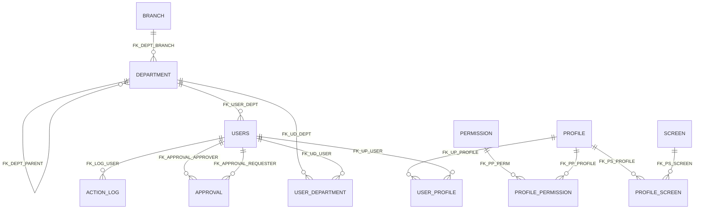

# firebird-5-mcp

A lightweight, pure-Rust MCP (Model Context Protocol) server for Firebird 5 databases. No external dependencies — no `isql`, no DLLs, no `.so` files. Just a single static binary.

## Features

### Schema & Structure
- `firebird_describe_database` — Complete database overview with Health section (gstat-like) + Mermaid ER diagram
- `firebird_describe_table` — Full schema of a table (columns, indexes, constraints, triggers, comments)
- `firebird_describe` — Multi-object describe (tables, views, procedures, functions, triggers, sequences, domains)
- `firebird_list` — List tables, views, procedures, functions, domains, triggers, indexes, sequences
- `firebird_check_duplicates` — Check for duplicate values before creating unique index/constraint

### DDL & Advanced
- `firebird_create_database` — Create a new Firebird database file
- `firebird_alter_column_type` — Change column type using domains
- `firebird_create_trigger` — Create BEFORE/AFTER INSERT/UPDATE/DELETE triggers
- `firebird_create_procedure` — Create stored procedures (no isql needed)
- `firebird_create_function` — Create user-defined functions
- `firebird_create_sequence` — Create sequences (generators)
- `firebird_drop` — Drop tables, views, domains, triggers, procedures, functions, indexes, sequences
- `firebird_run_script` — Execute multi-statement SQL scripts
- `firebird_execute_immediate` — Execute statements with SET TERM blocks (procedures, functions, generators)

### Query & Data
- `firebird_query` — Execute any SQL statement (SELECT, INSERT, UPDATE, DELETE, DDL)
- `firebird_count` — Count rows in a table (with optional WHERE)
- `firebird_sample` — Quick sample of table data
- `firebird_insert_batch` — Batch insert multiple rows in one transaction

### Code Generation
- `firebird_generate_dev` — Generate development code from table schemas (Java, Go, Rust, TypeScript, Protobuf, OpenAPI, GraphQL, Lazarus, Svelte 5)
- `firebird_generate_view_dto` — Generate DTOs/records from views (same languages)

### Discovery
- `firebird_get_databases` — List configured databases
- `firebird_metadata_extract` — Full DDL extraction (replaces `isql -x`)
- `firebird_explain_plan` — Get execution plan without running the query (rolled-back transaction)
- `firebird_find_column` — Find columns by name pattern (LIKE) across all tables/views

### Introspection
- `firebird_table_stats` — Per-table row counts (single table or all tables)
- `firebird_users` — List all users with database access (creators + grants)
- `firebird_grants` — Show GRANTs for a table or all tables
- `firebird_blob_info` — List BLOB columns with subtype (TEXT/BINARY)
- `firebird_index_usage` — Show all indexes with columns, uniqueness, and type

### Data Migration
- `firebird_export` — Export table/view/SQL to Parquet, Arrow IPC, CSV, DBF, or JSON Lines (with compression)
- `firebird_import` — Import Parquet/IPC/CSV/DBF/JSONL into Firebird table (create/append + ignore_columns)
- `firebird_describe_file` — Inspect file schema without loading data (no DB connection needed)

> **⚠️ Not recommended for production databases.**
> This MCP is designed for development and analysis workflows. Tools like code generation,
> DDL operations, and refactoring instructions can be destructive. For production,
> use a dedicated admin tool (e.g. `isql`, `fbguard`, or your DBA's preferred suite).

> **Coming soon:** a **safe-readonly** mode.

## Prerequisites

- **Firebird 5** server running (or any version 3+)
- No `isql`, no ODBC, no native libraries required

## Configuration

### `config.json`

The configuration file defines the Firebird server connection and the list of databases available to the MCP tools.

```json
{
  "server": {
    "host": "localhost",
    "port": 3050,
    "user": "SYSDBA",
    "password": "masterkey",
    "allowed_paths": ["/path/to/databases"],
    "databases": [
      {
        "name": "examples",
        "description": "Local development database",
        "path": "/path/to/databases/examples.fdb"
      }
    ],
    "default_database": "examples"
  }
}
```

| Field | Description |
|-------|-------------|
| `host` | Firebird server hostname |
| `port` | Firebird server port (default 3050) |
| `user` | Database username |
| `password` | Database password |
| `allowed_paths` | Directories where new databases can be created |
| `databases` | List of configured databases |
| `default_database` | Database to use when none is specified |

### Database entry

Each entry in the `databases` array:

```json
{
  "name": "examples",
  "description": "Local development database",
  "path": "/path/to/databases/examples.fdb"
}
```

### Configuration file lookup

The server looks for `config.json` in this order:
1. `FIREBIRD_CONFIG` environment variable (full path)
2. `./config.json` (current working directory)
3. `~/.firebird-mcp/config.json` (default)

> **Note:** On first run, if `~/.firebird-mcp/config.json` doesn't exist, the server creates an empty config file at that location. You can then edit it to add your server connection and databases.

The base directory can be overridden with `FIREBIRD_MCP_HOME` (e.g. for testing or non-standard installs).

### Environment variables

| Variable | Description |
|----------|-------------|
| `FIREBIRD_CONFIG` | Full path to `config.json` (highest priority) |
| `FIREBIRD_MCP_HOME` | Override the base directory (default: `~/.firebird-mcp`) |

## Setup Guides

| Guide | Description |
|-------|-------------|
| [README_ZED_EDITOR.md](README_ZED_EDITOR.md) | Configure in Zed Editor |
| [README_VSCODE.md](README_VSCODE.md) | Configure in VSCode & Cursor |
| [README_JETBRAINS.md](README_JETBRAINS.md) | Configure in JetBrains IDEs |
| [README_COMMAND_LINE.md](README_COMMAND_LINE.md) | Use from the command line (no IDE) |
| [examples/freePascal/README.md](examples/freePascal/README.md) | Free Pascal / Lazarus integration |
| [README_CODEGEN.md](README_CODEGEN.md) | Code generation examples (all languages) |
| [README_FOR_DEVS.md](README_FOR_DEVS.md) | Build, cross-compilation, project structure |
| [README_MIGRATIONS.md](README_MIGRATIONS.md) | Data migration (Parquet/IPC/CSV/DBF) |
| [README_FOR_HUMANS.md](README_FOR_HUMANS.md) | Use it as a plain CLI — no AI agent needed |
| [README-PTBR.md](README-PTBR.md) | This README in Portuguese (Brazil) |

## Tools

### `firebird_query`

Executes a single SQL statement. For DML/DDL, the execution plan is appended to the result.

**Arguments:**
- `sql` (required): The SQL statement
- `database` (optional): Database name (defaults to `default_database`)

**Example:**
```json
{
  "sql": "SELECT * FROM CLIENTS WHERE CITY = 'New York'",
  "database": "shop"
}
```

**Result:**
### Query Results (3 rows)

Columns: ID (INT), NAME (VARCHAR), CITY (VARCHAR)

ID | NAME | CITY
--- | --- | ---
1 | Alice | New York
2 | Bob | NULL
3 | Charlie | New York

### `firebird_list`

Lists database objects by type.

**Arguments:**
- `type` (required): TABLES, PROCEDURES, FUNCTIONS, DOMAINS, TRIGGERS, INDEXES, or SEQUENCES
- `database` (optional): Database name

**Example:**
```json
{
  "type": "TABLES",
  "database": "shop"
}
```

**Result:**
### Tables and Views (5)

NAME | TYPE | COMMENT
--- | --- | ---
CLIENTS | TABLE | Customer records
ORDERS | TABLE | Order data
...

### `firebird_find_column`

Finds columns by name pattern across all tables and views. Supports `%` wildcards.

**Arguments:**
- `column` (required): Column name pattern (supports `%` wildcards). E.g., `EMAIL`, `%NOME%`, `ID`
- `database` (optional): Database name

**Example:**
```json
{
  "column": "%EMAIL%",
  "database": "shop"
}
```

**Result:**
### Columns matching '%EMAIL%' (2 found)

TABLE | COLUMN | TYPE | NULL | VIEW
--- | --- | --- | --- | ---
USERS | EMAIL | VARCHAR(250) | NO |
VW_ACTIVE_USERS | EMAIL | VARCHAR(250) | YES | YES

### `firebird_check_duplicates`

Checks for duplicate values in one or more columns. Use this BEFORE creating a unique index or constraint to verify data integrity. Supports composite keys.

**Arguments:**
- `table` (required): Table name to check
- `columns` (required): Array of column names to check (supports composite keys)
- `limit` (optional): Maximum number of duplicate combinations to return (default: 10)
- `database` (optional): Database name

**Example:**
```json
{
  "table": "CUSTOMERS",
  "columns": ["TYPE_ID"],
  "database": "shop"
}
```

**Result (with duplicates):**
### Duplicate Check: CUSTOMERS (TYPE_ID)

⚠️ 1 duplicate combination(s) found:

TYPE_ID | DUPLICATED_COUNT
--- | ---
2 | 5

#### Full rows for first duplicate (TYPE_ID = 2):

ID | TYPE_ID | PARENT_ID | IS_VERIFIED | ACTIVE | ...
--- | --- | --- | --- | --- | ---
2 | 2 | NULL | false | true | ...
3 | 2 | 2 | true | true | ...
4 | 2 | NULL | false | true | ...
5 | 2 | 4 | true | true | ...
6 | 2 | 4 | false | true | ...

💡 Fix duplicates before creating the unique index/constraint.


**Result (no duplicates):**
### Duplicate Check: CUSTOMERS (ID)

✅ No duplicates found. Safe to create unique index/constraint.

### `firebird_describe_table`

Shows the full schema of a table or view.

**Arguments:**
- `table_name` (required): Table or view name
- `database` (optional): Database name

**Result:**
### Table: CLIENTS

#### Columns

NAME | TYPE | NULL | DEFAULT | POSITION
--- | --- | --- | --- | ---
ID | INTEGER | NO | - | 1
NAME | VARCHAR(100) | NO | - | 2
EMAIL | VARCHAR(255) | YES | - | 3
CREATED_AT | TIMESTAMP | NO | CURRENT_TIMESTAMP | 4

#### Indexes

NAME | UNIQUE | TYPE | COLUMNS
--- | --- | --- | ---
PK_CLIENTS | YES | 0 | ID

#### Constraints

NAME | TYPE
--- | ---
PK_CLIENTS | PRIMARY KEY

### `firebird_describe_database`

Provides a complete overview of the database structure with a Health section (gstat-like info) and a Mermaid ER diagram.

**Arguments:**
- `database` (optional): Database name
- `include_counts` (optional): Include row counts (may be slow)
- `include_describes` (optional): Include column details

**Result:**

### Database: test-mcp

#### Health

- **Path:** /database/test-mcp.fdb
- **ODS Version:** 13.1
- **Page Size:** 32768 bytes
- **File Size:** 283 pages (~8.8 MB)
- **Dialect:** 3
- **Mode:** Online (Normal)
- **Read-Only:** NO
- **Forced Writes:** YES
- **Active Connections:** 1
- **Oldest Transaction:** 361 (active: 362, next: 362)
- **Buffer Pool:** 2048 pages

#### Tables (14)

**USERS** (10 rows)
- ID (INTEGER)
- DEPARTMENT_ID (INTEGER)
- NAME (VARCHAR(25))
- EMAIL (VARCHAR(50))
- PASSWORD_HASH (VARCHAR(125))
- ACTIVE (BOOLEAN)
- SALARY (NUMERIC(14,2))
- HIRED_AT (DATE)
- CREATED_AT (TIMESTAMP)
- UPDATED_AT (TIMESTAMP)

**DEPARTMENT** (10 rows)
- ID (INTEGER)
- BRANCH_ID (INTEGER)
- PARENT_ID (INTEGER, NOT NULL)
- NAME (VARCHAR(25))
- CODE (VARCHAR(5))
- TYPE (VARCHAR(5))
- ACTIVE (BOOLEAN, NOT NULL)
- CREATED_AT (TIMESTAMP)
- UPDATED_AT (TIMESTAMP)

**BRANCH** (4 rows)
- ID (INTEGER)
- NAME (VARCHAR(25))
- CODE (VARCHAR(2))
- ACTIVE (BOOLEAN)
- CREATED_AT (TIMESTAMP)
- UPDATED_AT (TIMESTAMP)

**PROFILE** (5 rows)
- ID (INTEGER)
- NAME (VARCHAR(25))
- DESCRIPTION (VARCHAR(125), NOT NULL)
- ACTIVE (BOOLEAN)
- CREATED_AT (TIMESTAMP)

**PERMISSION** (10 rows)
- ID (INTEGER)
- CODE (VARCHAR(12))
- NAME (VARCHAR(25))
- MODULE (VARCHAR(12))
- ACTIVE (BOOLEAN)

**SCREEN** (8 rows)
- ID (INTEGER)
- NAME (VARCHAR(25))
- MODULE (VARCHAR(12))
- PATH (VARCHAR(50))
- ACTIVE (BOOLEAN, NOT NULL)

**USER_PROFILE** (10 rows)
- ID (INTEGER)
- USER_ID (INTEGER)
- PROFILE_ID (INTEGER)

**USER_DEPARTMENT** (12 rows)
- ID (INTEGER)
- USER_ID (INTEGER)
- DEPARTMENT_ID (INTEGER)
- PRIMARY_FLAG (BOOLEAN, NOT NULL)
- START_DATE (DATE)
- END_DATE (DATE, NOT NULL)
- ACTIVE (BOOLEAN, NOT NULL)

**PROFILE_PERMISSION** (25 rows)
- ID (INTEGER)
- PROFILE_ID (INTEGER)
- PERMISSION_ID (INTEGER)

**PROFILE_SCREEN** (20 rows)
- ID (INTEGER)
- PROFILE_ID (INTEGER)
- SCREEN_ID (INTEGER)

**ACTION_LOG** (10 rows)
- ID (INTEGER)
- USER_ID (INTEGER)
- ACTION (VARCHAR(12))
- ENTITY (VARCHAR(12))
- ENTITY_ID (INTEGER, NOT NULL)
- DETAILS (VARCHAR(250), NOT NULL)
- CREATED_AT (TIMESTAMP)

**APPROVAL** (8 rows)
- ID (INTEGER)
- REQUESTER_ID (INTEGER)
- APPROVER_ID (INTEGER)
- STATUS (VARCHAR(5))
- REASON (VARCHAR(125), NOT NULL)
- APPROVED_AT (TIMESTAMP, NOT NULL)
- CREATED_AT (TIMESTAMP)

#### Relationships (Mermaid)



**Health section fields:**
| Field | Description |
|-------|-------------|
| Path | Database file path |
| ODS Version | On-Disk Structure version (13.1 = Firebird 5) |
| Page Size | Page size in bytes |
| File Size | Total pages and estimated size in MB |
| Dialect | SQL dialect (3 = ANSI) |
| Mode | Shutdown mode: Online (Normal), Multi-user, Single-user, Full |
| Read-Only | Whether the database is read-only |
| Forced Writes | Whether forced writes are enabled |
| Active Connections | Number of active user connections |
| Oldest Transaction | Oldest transaction ID (active and next) |
| Buffer Pool | Number of buffer pool pages |

### `firebird_describe`

Multi-object describe — accepts any mix of tables, views, procedures, functions, triggers, sequences, and domains.

**Arguments:**
- `objects` (required): Array of object names
- `database` (optional): Database name

**Example:**
```json
{
  "objects": ["SAVE_USER", "USERS", "D_BOOL"],
  "database": "shop"
}
```

**Result (procedure with parameters):**
### SAVE_USER (PROCEDURE)

#### Input Parameters

POSITION | NAME | DOMAIN
--- | --- | ---
0 | P_OPER | RDB$33
1 | P_ID | D_ID_NULL
2 | P_EMAIL | D_VC255
...

#### Output Parameters

POSITION | NAME | DOMAIN
--- | --- | ---
0 | ID | D_ID
1 | OK | D_BOOL

#### Source

CREATE PROCEDURE SAVE_USER (P_OPER RDB$33, P_ID D_ID_NULL, ...)
AS
DECLARE VARIABLE V_AFF INT;
BEGIN
    ...
END

### `firebird_generate_dev`

Generates development code from table schemas. See [README_CODEGEN.md](README_CODEGEN.md) for examples in all supported languages.

**Arguments:**
- `tables` (required): Array of table names (max 20)
- `language` (required): `java`, `go`, `rust`, `typescript`, `protobuf`, `openapi`, `graphql`, `lazarus`, or `svelte`
- `database` (optional): Database name
- `include_fks` (optional): If true, generates named FK relations (Java `@ManyToOne`) or FK comments

### `firebird_explain_plan`

Gets the execution plan for a SQL statement without actually running it. The statement is executed inside a rolled-back transaction.

**Arguments:**
- `sql` (required): The SQL statement
- `database` (optional): Database name

**Result:**
Execution plan (the statement was executed inside a rolled-back transaction):
PLAN:
  SORT
    TABLE: CLIENTS (INDEX: PK_CLIENTS)

### `firebird_metadata_extract`

Extracts complete database metadata (DDL) using system tables. Replaces `isql -x`.

**Arguments:**
- `database` (optional): Database name
- `objects` (optional): Array of object names to filter (e.g., `["CLIENTS", "ORDERS"]`)

**Result:**
```sql
CREATE TABLE CLIENTS (
    ID INTEGER NOT NULL,
    NAME VARCHAR(100) NOT NULL,
    EMAIL VARCHAR(255),
    CREATED_AT TIMESTAMP DEFAULT CURRENT_TIMESTAMP NOT NULL,
    CONSTRAINT PK_CLIENTS PRIMARY KEY (ID)
);

CREATE INDEX IDX_CLIENTS_EMAIL ON CLIENTS (EMAIL);
...
```

### `firebird_table_stats`

Returns per-table row counts. For a single table, uses `SELECT COUNT(*) FROM <table>`. For all tables, uses an `EXECUTE BLOCK` with `EXECUTE STATEMENT` to dynamically count each table.

**Arguments:**
- `table` (optional): Table name. Omit to get stats for all tables.
- `database` (optional): Database name

**Result:**
## Table Stats (all tables)

TABLE_NAME | TOTAL
--- | ---
ACTION_LOG | 10
APPROVAL | 8
BRANCH | 4
DEPARTMENT | 10
PERMISSION | 10
PROFILE | 5
PROFILE_PERMISSION | 25
PROFILE_SCREEN | 20
SCREEN | 8
USERS | 10
USER_DEPARTMENT | 12
USER_PROFILE | 10

> **Note:** `COUNT(*)` on very large tables can be slow. Intended for development/analysis.

### `firebird_users`

Lists all users with access to the database, combining `RDB$DB_CREATORS` (database owners) with `RDB$USER_PRIVILEGES` (users with explicit grants).

**Arguments:**
- `database` (optional): Database name

**Result:**
## Database Users

USER_NAME | CREATOR_TYPE | PRIVILEGE | GRANT_OPTION
--- | --- | --- | ---
SYSDBA | 0 |  | 
APP_USER |  | SELECT | 
APP_USER |  | INSERT | 
APP_USER |  | UPDATE | 

> **Note:** Privileges are shown as single letters: `S` = SELECT, `I` = INSERT, `U` = UPDATE, `D` = DELETE, `R` = REFERENCES, `G` = GRANT OPTION.

### `firebird_grants`

Shows GRANT privileges for a specific table or for all tables, using `RDB$USER_PRIVILEGES`.

**Arguments:**
- `table` (optional): Table name. Omit to show grants for all tables.
- `database` (optional): Database name

**Result:**
## Grants for CLIENTS

RELATION_NAME | GRANTEE | PRIVILEGE | GRANT_OPTION
--- | --- | --- | ---
CLIENTS | APP_USER | SELECT | 
CLIENTS | APP_USER | INSERT | 
CLIENTS | APP_USER | UPDATE | 

### `firebird_blob_info`

Lists all BLOB columns in the database (or a specific table): table, column, blob subtype (TEXT/BINARY), and field length.

**Arguments:**
- `table` (optional): Table name. Omit to list BLOB columns in all tables.
- `database` (optional): Database name

**Result:**
## BLOB Columns (all tables)

RELATION_NAME | FIELD_NAME | FIELD_TYPE | SUB_TYPE | LENGTH | BLOB_TYPE
--- | --- | --- | --- | --- | ---
DOCUMENTS | CONTENT | 261 | 1 | 0 | TEXT
INVOICES | PDF_DATA | 261 | 2 | 0 | BINARY

### `firebird_index_usage`

Shows all indexes in the database (or a specific table): index name, table, uniqueness, type, and columns.

**Arguments:**
- `table` (optional): Table name. Omit to show indexes for all tables.
- `database` (optional): Database name

**Result:**

## Indexes (all tables)

INDEX_NAME | RELATION_NAME | UNIQUE_FLAG | INDEX_TYPE | COLUMNS
--- | --- | --- | --- | ---
PK_CLIENTS | CLIENTS | 2 | 0 | ID
IDX_CLIENTS_EMAIL | CLIENTS | 1 | 0 | EMAIL
IDX_ORDERS_CLIENT | ORDERS | 0 | 0 | CLIENT_ID, CREATED_AT

| UNIQUE_FLAG | Meaning |
|---|---|
| 0 | Non-unique |
| 1 | Unique |
| 2 | Primary key |

## Credits

- [rsfbclient](https://crates.io/crates/rsfbclient) — Pure-Rust Firebird client driver (no native libraries required)
- [jedSvelted-ui](https://github.com/edujed/jedSvelted-ui) — Svelte 5 component library used by the Svelte code generator (`@edujed/jedsvelted-ui`)
- [Model Context Protocol](https://modelcontextprotocol.io) — The MCP specification

## License

MIT — see [LICENSE](LICENSE).
